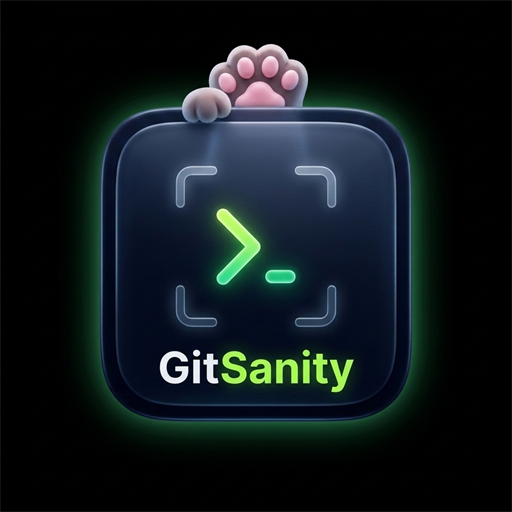

<div align="center">

  

  # GitSanity
  
  ### *Scan, secure, and commit safely.*
  
  **The zero-dependency developer guardrail that catches leaked secrets, forgotten logs, stray breakpoints, and merge conflicts before they enter your Git history.**

  <p align="center">
    <a href="#features"></a>
    <a href="#license"></a>
    <a href="https://code.visualstudio.com/"></a>
    <a href="#privacy--security"></a>
    <a href="#architecture"></a>
  </p>

  <p align="center">
    <a href="#quick-start"><b>Quick Start</b></a> •
    <a href="#key-features"><b>Key Features</b></a> •
    <a href="#smart-auto-fix-move-to-env"><b>Move to .env</b></a> •
    <a href="#pre-commit-hook--safe-commit"><b>Pre-Commit Hook</b></a> •
    <a href="#activity-bar--sidebar"><b>Activity Bar</b></a> •
    <a href="#configuration"><b>Configuration</b></a>
  </p>

</div>

---

## ⚡ Why GitSanity?

Accidentally pushing an API key or an unverified commit can lead to compromised infrastructure, unexpected cloud bills, or broken main branches. 

**GitSanity runs directly in your editor and your Git lifecycle to protect you at three critical stages:**

```
   [ Editor Typing ]   ──▶   [ Pre-Commit Hook ]   ──▶   [ Pre-Push / Publish ]
    300ms Live Lint           Git Index Inspection          Full History Scan
  (Squigglies & Fixes)      (Blocks Bad Commits)       (Finds Past Compromises)
```

1. **While you write**: Instantly flags credentials, forgotten `console.log` statements, and breakpoint `debugger;` calls.
2. **When you commit**: A bundled pre-commit hook verifies the **staged Git index** (`git show :path`), preventing commits containing `.env` files or secrets even if you bypass the editor.
3. **When you review**: An interactive **Review Before Commit** panel with human checklists and streak tracking gives you peace of mind before shipping.

---

## 🚀 Key Features

<table>
  <tr>
    <td width="50%">
      <h3>🪄 Move Secret to <code>.env</code></h3>
      <p>Click the lightbulb on any hardcoded token. GitSanity automatically appends it to <code>.env</code>, registers a placeholder in <code>.env.example</code>, protects <code>.gitignore</code>, and updates your source code with native language expressions (JS/TS, Python, Go, Ruby, PHP, Java, C#, Shell).</p>
    </td>
    <td width="50%">
      <h3>🐾 Activity Bar Sidebar</h3>
      <p>A native VS Code Activity Bar panel featuring live workspace safety health, active Git branch, pre-commit hook status, clean commit streak counter, and 1-click Quick Action triggers.</p>
    </td>
  </tr>
  <tr>
    <td width="50%">
      <h3>🪝 Fail-Safe Pre-Commit Hook</h3>
      <p>Standalone, zero-dependency Git hook that inspects the <b>Git index</b> directly. Preserves existing hooks via marker blocks, enforces LF line endings on Windows, and fails open if an internal error occurs.</p>
    </td>
    <td width="50%">
      <h3>🛡️ Safe Commit & Review Panel</h3>
      <p>Interactive webview with automated Conventional Commit suggestions, protected branch warnings (<code>main</code>/<code>master</code>), and 1-click <b>Push</b> and <b>Undo Last Commit</b> safety controls.</p>
    </td>
  </tr>
  <tr>
    <td width="50%">
      <h3>📊 Streaks & Analytics Dashboard</h3>
      <p>Gamified clean commit streak counter, unlockable milestones (7, 30, 100 clean commits), and pure inline SVG issue trend charts across the last 8 weeks.</p>
    </td>
    <td width="50%">
      <h3>⏰ Old TODO Detector</h3>
      <p>Uses <code>git blame</code> caching to surface stale <code>TODO</code>, <code>FIXME</code>, and <code>HACK</code> comments older than 90 days. Jump directly to forgotten technical debt in one click.</p>
    </td>
  </tr>
</table>

---

## 🏃 Quick Start

### 1. Installation
Install from the VS Code Marketplace or install the pre-packaged `.vsix`:
```bash
code --install-extension gitsanity-0.1.0.vsix
```

### 2. Live Diagnostics
Open any file and start typing. GitSanity flags security issues with zero configuration:
- 🟡 **Yellow squiggly**: Warnings like forgotten `console.log(...)` or old TODOs.
- 🔴 **Red squiggly**: Errors like AWS keys (`AKIA...`), generic secrets (`api_key = "..."`), merge conflict markers (`<<<<<<<`), or `debugger;`.

### 3. One-Click Fix
Press <kbd>Ctrl</kbd>+<kbd>.</kbd> (or <kbd>Cmd</kbd>+<kbd>.</kbd> on macOS) on any flagged line:
- **`GitSanity: Remove this console.log line`**: Deletes the debug statement instantly.
- **`GitSanity: Move secret to .env`**: Migrates the secret out of your code and secures it in your environment.

### 4. Activate Pre-Commit Protection
Open the Command Palette (<kbd>Ctrl</kbd>+<kbd>Shift</kbd>+<kbd>P</kbd>) and run:
```
GitSanity: Install Pre-commit Hook
```
*Your local Git repository is now shielded against accidental secret leaks in both terminal and GUI commits!*

---

## 🪄 Smart Auto-Fix: "Move to .env"

Hardcoding credentials directly into source code is the #1 cause of repository secret leaks. GitSanity automates the migration in one keypress:

```diff
- const stripeKey = "YOUR_STRIPE_SECRET_KEY";
+ const stripeKey = process.env.STRIPE_KEY;
```

### What happens behind the scenes:
1. **Name Transformation**: Converts variable names to uppercase snake_case (`stripeKey` ➔ `STRIPE_KEY`).
2. **Collision Prevention**: If `STRIPE_KEY` already exists with a different value in `.env`, GitSanity automatically creates `STRIPE_KEY_2`.
3. **`.env` Upsert**: Appends the key-value pair to `.env` while preserving the file's original line endings (`LF` vs `CRLF`).
4. **`.env.example` Sync**: Appends `STRIPE_KEY=` without the secret value so your team knows what to configure.
5. **`.gitignore` Defense**: Immediately verifies `.gitignore` and appends `.env` if not already ignored.
6. **Disk-First Ordering**: Writes `.env` to disk **before** modifying your code buffer, ensuring no secret is lost.

### Multi-Language Syntax Support:

| Language | Generated Code | Insertion Helper |
|---|---|---|
| **JavaScript / TypeScript** | `process.env.VARIABLE_NAME` | — |
| **Python** | `os.environ["VARIABLE_NAME"]` | Automatically inserts `import os` if missing |
| **Go** | `os.Getenv("VARIABLE_NAME")` | Provides import hint for `"os"` |
| **Ruby** | `ENV["VARIABLE_NAME"]` | Native ENV lookup |
| **PHP** | `getenv('VARIABLE_NAME')` | Native getenv lookup |
| **Java** | `System.getenv("VARIABLE_NAME")` | Native System lookup |
| **C#** | `Environment.GetEnvironmentVariable("VARIABLE_NAME")` | Native Environment lookup |
| **Shell (bash/sh)** | `${VARIABLE_NAME}` | Native POSIX syntax |

---

## 🐾 Activity Bar & Sidebar

GitSanity includes a dedicated **Activity Bar Sidebar** accessible via the Cat Paw icon in the left navigation rail:

```
[Activity Bar]
├── 🛡️ Status & Safety
│   ├── Safety: Clean (0 issues)  [or X errors, Y warnings]
│   ├── Branch: main
│   ├── Pre-commit Hook: Active
│   └── Clean Streak: 5 clean commit(s)
└── ⚡ Quick Actions
    ├── Safe Commit
    ├── Review Before Commit
    ├── Show Dashboard
    ├── Health Report
    ├── Scan Entire Project
    ├── Scan Git Commit History
    ├── Find Old TODOs
    ├── Install Pre-commit Hook
    └── Create Config File
```

---

## 🪝 Pre-Commit Hook & Safe Commit

### The Problem With Normal Hooks
Many pre-commit hooks scan files in the working directory on disk. If a developer runs `git add .`, modifies a file to remove the secret, and runs `git commit`, the secret is still staged in the Git index!

### The GitSanity Solution
GitSanity's hook executes `git show :<path>` directly against the **staged Git index blob**:
- **Index-Accurate**: Scans what is *actually* being committed, not what is on disk.
- **Staged `.env` Blocker**: Rejects commits containing `.env`, `.env.local`, `.env.production` (exempting `.env.example`).
- **Large File Alert**: Warns if any staged file exceeds the size cap (default 5 MB).
- **Non-Destructive**: Integrates into existing `.git/hooks/pre-commit` scripts using `# >>> GitSanity >>>` markers. Compatible with Husky and Lefthook.

---

## ⚙️ Configuration (`.gitsanity.json`)

Customize rules and tolerances by creating a `.gitsanity.json` file in your repository root, or run **`GitSanity: Create Config File`**:

```json
{
  "$schema": "./schemas/gitsanity.schema.json",
  "rules": {
    "console-log": "warn",
    "debugger": "error",
    "conflict-marker": "error",
    "secret": "error",
    "high-entropy-string": "warn",
    "old-todo": "off"
  },
  "ignorePaths": [
    "tests/**",
    "scripts/**",
    "docs/**/*.md"
  ],
  "maxFileSizeMB": 1,
  "entropyThreshold": 4.5,
  "entropyMinLength": 20,
  "envFile": ".env",
  "envExampleFile": ".env.example",
  "createEnvExample": true,
  "largeFileMB": 5,
  "maxProjectFiles": 20000,
  "blockOnWarnings": false,
  "todoMaxAgeDays": 90
}
```

### Inline Ignore Directives

Temporarily suppress warnings in code using inline comment directives in any programming language:

```javascript
// Suppress all rules on this line
console.log("Telemetry payload"); // gitsanity-ignore

// Suppress only specific rules
const tempKey = "TESTING_CREDENTIAL_12345"; // gitsanity-ignore secret, high-entropy-string

// Suppress the next line
// gitsanity-ignore-next-line
debugger;

// Suppress the entire file (place within first 10 lines)
// gitsanity-ignore-file
```

---

## ⌨️ Command Palette Reference

| Command | Title | Purpose |
|---|---|---|
| `gitsanity.menu` | **GitSanity: Show Menu** | Opens the interactive GitSanity QuickPick hub |
| `gitsanity.safeCommit` | **GitSanity: Safe Commit** | Pre-flight index scan + Conventional Commit flow |
| `gitsanity.reviewBeforeCommit` | **GitSanity: Review Before Commit** | Opens the visual staged changes review panel |
| `gitsanity.showDashboard` | **GitSanity: Show Dashboard** | Opens the Analytics, Streaks & Chart webview |
| `gitsanity.showHealthReport` | **GitSanity: Show Health Report** | Deep diagnostic report of the active repository |
| `gitsanity.scanProject` | **GitSanity: Scan Project** | Scans all workspace files (respects Git ignores) |
| `gitsanity.scanHistory` | **GitSanity: Scan Git History** | Streams `git log -p` diffs to unearth past leaks |
| `gitsanity.findOldTodos` | **GitSanity: Find Old TODOs** | Evaluates commit dates via `git blame` for stale TODOs |
| `gitsanity.installHook` | **GitSanity: Install Pre-commit Hook** | Installs fail-safe pre-commit hook into `.git/hooks` |
| `gitsanity.uninstallHook` | **GitSanity: Uninstall Pre-commit Hook** | Cleanly removes the GitSanity hook block |
| `gitsanity.undoLastCommit` | **GitSanity: Undo Last Commit** | Safe soft-reset (`HEAD~1`) keeping changes staged |
| `gitsanity.publishToGitHub` | **GitSanity: Publish to GitHub** | Creates remote GitHub repository and pushes branch |
| `gitsanity.createConfig` | **GitSanity: Create Config File** | Generates `.gitsanity.json` with schema validation |
| `gitsanity.rescanOpenFiles` | **GitSanity: Rescan Open Files** | Forces immediate live re-scan across all open editors |

---

## 🔒 Privacy & Security First

- 💻 **100% Local Execution**: All scanning, regex evaluation, entropy computation, and Git operations execute entirely on your machine.
- 🚫 **Zero Telemetry**: No tracking, no external pings, and no analytics collection.
- 🙈 **Token Redaction**: Any token, credential, or URL info printed to output channels or notifications is strictly redacted (`AKIAIOSF...` ➔ `AKI***`).
- 🛡️ **Workspace Trust**: In untrusted workspaces (Restricted Mode), all Git execution, hook installation, and CLI capabilities are disabled. Live in-editor text scanning continues safely.
- 📦 **Zero Runtime Dependencies**: Packaged with pure TypeScript and Node.js built-ins. No external npm supply chain vulnerabilities.

---

## ⏱️ Benchmark & Performance

Tested on a standard development machine:

- ⚡ **Extension Activation**: **8 ms** (lazy-loaded modules).
- ⚡ **50,000-Line File Scan**: **136 ms** (~367,000 lines/sec).
- ⚡ **5 MB File Scan**: **398 ms** (~12.5 MB/sec).
- ⚡ **20,000-File Project Scan**: **3.4 seconds** (~5,800 files/sec).
- ⚡ **ReDoS Immunity**: 100 KB single-line adversarial payload finishes in **0 ms** (5,000-char scan cap).

---

## 📄 License

Distributed under the **MIT License** (2026). See [LICENSE](LICENSE) for full terms.

<div align="center">
  <sub>Built with ❤️ and sanity for the global developer community.</sub>
</div>
